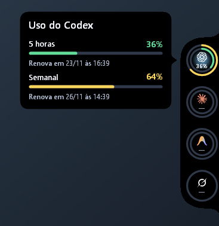

# Usage LLMs

O Usage LLMs é um widget para Windows que mostra quanto você já consumiu das cotas de **5 horas** e **semanal** do Codex. Ele fica na borda da tela e atualiza as leituras a cada 30 segundos.

## Baixar para Windows

[](../../releases/latest/download/Usage-LLMs-Windows.exe)

Abra o arquivo `Usage-LLMs-Windows.exe` baixado. O app é portátil e requer Windows de 64 bits com .NET Framework 4.8 ou 4.8.1. O Windows pode exibir um aviso porque o executável está sem assinatura digital.

## Como usar

1. Para ver suas cotas, entre na sua conta ChatGPT pelo Codex CLI ou pela extensão oficial do Codex para VS Code. [Instalar o Codex CLI](https://github.com/openai/codex#quickstart)
2. O número abaixo do ícone do Codex mostra a cota de 5 horas, ou a semanal quando for a única disponível. Passe o mouse para ver as duas cotas e os horários de renovação. O brilho indica atividade em uma sessão local.
3. Arraste o widget para mudar de borda. Clique com o botão direito para ajustar tamanho e cores, escolher quais provedores aparecem ou ativar a inicialização com o Windows.



*Imagem ilustrativa. As cotas reais estão disponíveis para o Codex. Claude Code, Antigravity e Grok Build aparecem como prévias da interface.*

## Compilar

Clone o repositório e execute estes comandos no PowerShell, a partir da pasta do projeto:

```powershell
powershell.exe -NoProfile -ExecutionPolicy Bypass -File .\Build.ps1
& '.\bin\Usage LLMs.exe'
```

Use `-Release` no comando de build para gerar `bin\Usage-LLMs-Windows.exe`, o arquivo da GitHub Release.

## Créditos

Projeto independente, inspirado no Codenotch. O símbolo exibido para o Codex vem da extensão oficial da OpenAI para VS Code. [Codenotch](https://github.com/vinzdg/codenotch) · [Créditos dos demais ícones](src/provider-marks.LICENSE.txt)
